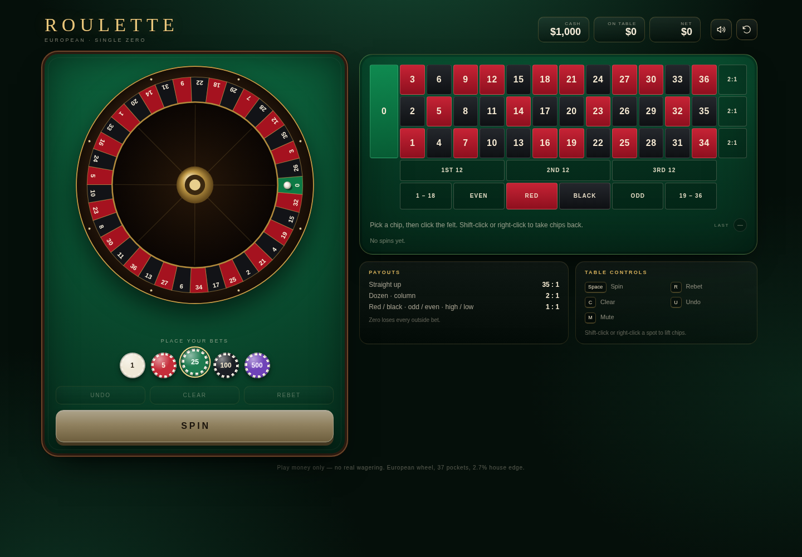

# Roulette

A single-zero European roulette table that runs entirely in the browser. No build step, no dependencies, no frameworks, no tracking. Green felt, brass frets, and a ball that actually lands where the result says it did.

**Play it:** <https://nick7612.github.io/roulette/>



## What's inside

- **A real wheel.** Drawn on a `<canvas>` in the true European pocket order, with the correct red/black layout, spinning ball, inward drop, bounces, and a gold marker on the winning pocket.
- **Honest spin.** The winning pocket is drawn first with `crypto.getRandomValues`, then the animation is solved backwards so the ball always settles on that exact pocket. The visual can never disagree with the payout.
- **Full outside board.** 0–36 straight up, red/black, odd/even, 1–18/19–36, three dozens and three columns, with casino payouts (35:1, 2:1, 1:1).
- **Chip rail.** $1, $5, $25, $100 and $500 chips. Click the felt to stack, shift-click or right-click to take chips back. Undo, Clear, and Rebet like a real table.
- **Hover preview.** Hovering or focusing a bet lights up every number it covers and shows exactly what the selected chip would return.
- **Bankroll + persistence.** Start with $1,000. Cash, chips on the table, the last bet, result history and session stats survive a reload in `localStorage`.
- **Casino atmosphere.** Felt, wood, brass, chip stacks, a marquee of recent numbers, synthesized ball ticks, chip clacks and a win chime generated with WebAudio (no audio files).
- **Keyboard and touch.** `Space` spins, `R` rebets, `C` clears, `U` undoes, `M` mutes. Fully responsive down to phone width, with a scrollable felt on narrow screens.
- **Accessible.** Every spot is a real button with an odds-aware label, focus is visible, and results are announced politely.

## Payouts

| Bet | Pays |
| --- | --- |
| Straight up (single number) | 35 : 1 |
| Dozen / column | 2 : 1 |
| Red / black, odd / even, 1–18 / 19–36 | 1 : 1 |

Zero loses every outside bet. House edge is 2.7%, exactly as a single-zero table should be.

## Run it locally

It is plain static files, so any server works:

```sh
git clone https://github.com/Nick7612/roulette.git
cd roulette
python3 -m http.server 8000
# open http://localhost:8000
```

Opening `index.html` directly also works, though `localStorage` behaviour varies between browsers on `file://`.

## How it is put together

```
index.html        markup and the game shell
css/style.css     felt, brass, layout and responsive rules
js/audio.js       WebAudio synth for ticks, chips, chimes
js/wheel.js       canvas wheel drawing and ball flight physics
js/game.js        bets, payouts, bankroll, storage, UI events
```

No build, no `node_modules`, no external fonts or assets. Everything is served as-is.

## Disclaimer

This is a simulation with play money only. There is no wagering, no payments and no real-world prize. If gambling is a problem for you, please seek support in your country.
